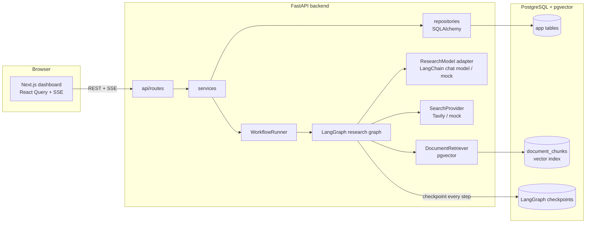
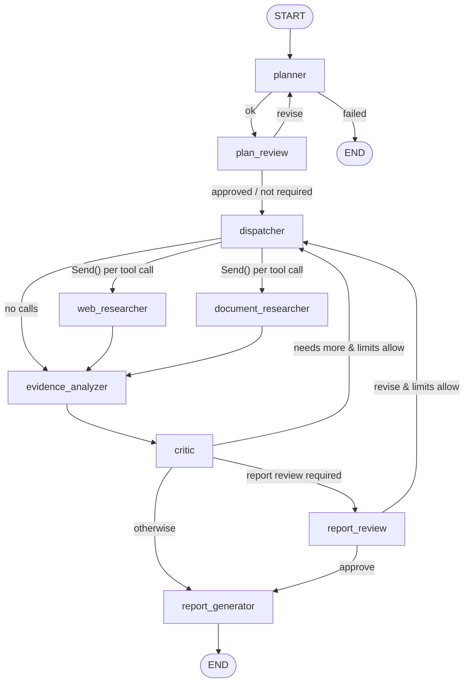
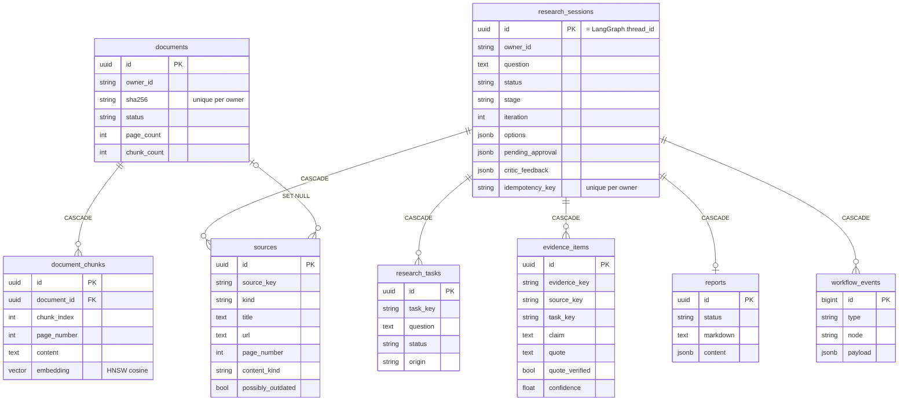

# ResearchFlow AI

An AI research assistant you can study and extend. You ask a complex question and upload documents if you have them. An explicit **LangGraph** workflow then plans subquestions, searches the web and your files in parallel, extracts evidence linked to its sources, critiques its own coverage, optionally pauses for your approval, and writes a report whose citations are **validated against the evidence it actually collected**.

It is a working full-stack app (FastAPI + Postgres/pgvector + Next.js), not a tutorial snippet. A **demo mode** runs everything offline and deterministically, with no API keys.

> New to LangChain/LangGraph? Read [`docs/LEARNING_GUIDE.md`](docs/LEARNING_GUIDE.md). It walks through this codebase in 12 progressive stages, with experiments.

---

## Contents

- [Quick start](#quick-start)
- [Architecture](#architecture)
- [The research graph](#the-research-graph)
- [RAG pipeline](#rag-pipeline)
- [Citations: how fabrication is prevented](#citations-how-fabrication-is-prevented)
- [API](#api)
- [Database schema](#database-schema)
- [Configuration](#configuration)
- [Testing and evaluation](#testing-and-evaluation)
- [Security and reliability](#security-and-reliability)
- [Design decisions](#design-decisions)
- [Known limitations and future work](#known-limitations-and-future-work)

---

## Quick start

Requirements: Docker. For local (non-Docker) development you also need Python ≥ 3.12 and Node ≥ 20.

### Option A: everything in Docker

```bash
cp .env.example .env          # demo mode by default (mock LLM, search and embeddings)
docker compose up -d --build  # Postgres+pgvector, backend (runs migrations on start), frontend
open http://localhost:3000    # UI
open http://localhost:8000/docs  # OpenAPI docs
```

### Option B: local development (hot reload)

```bash
cp .env.example .env
make setup      # venv + pip install -e ".[dev]" + npm install
make db         # Postgres+pgvector on host port 5433
make migrate    # Alembic migrations + LangGraph checkpoint tables
make backend    # http://localhost:8000  (terminal 1)
make frontend   # http://localhost:3000  (terminal 2)
```

### Using real providers

Edit `.env`:

```bash
LLM_PROVIDER=openai
EMBEDDING_PROVIDER=openai
SEARCH_PROVIDER=tavily
OPENAI_API_KEY=sk-...
TAVILY_API_KEY=tvly-...
```

Configuration is validated at startup. For example, selecting `openai` without a key fails immediately with a clear error. Keep `EMBEDDING_DIM` at the dimension your vectors were indexed with (see [RAG](#rag-pipeline)).

`make help` lists every developer command.

---

## Architecture

A modular monolith with clear boundaries:



| Layer | Path | Responsibility |
|---|---|---|
| API | `backend/app/api/routes/` | HTTP, validation, auth dependency, error envelope |
| Services | `backend/app/services/` | Use cases: create/resume research, upload documents, citation validation |
| Repositories | `backend/app/repositories/` | All SQL |
| AI | `backend/app/ai/` | Prompts, schemas, model adapter, tools, RAG, **graph** |
| Storage | `backend/app/storage/` | File storage abstraction (local filesystem now, object storage later) |
| Frontend | `frontend/features/*` | Feature folders: `research`, `documents`, `sessions` |

**Data flow of a research run**

1. `POST /api/v1/research` creates a `research_sessions` row and starts a background task.
2. The `WorkflowRunner` calls `graph.astream(..., stream_mode="updates")` with `thread_id = session id`.
3. After every node, the runner writes a `workflow_events` row and **projects** the checkpointed state into the `research_tasks`, `sources` and `evidence_items` tables.
4. The UI subscribes to `GET /research/{id}/events` (SSE). That endpoint streams the persisted event rows, so the progress you see is always real. Each event triggers a refetch of the session.
5. At an `interrupt()`, the session becomes `awaiting_approval`. `POST /approve` or `/revise` resumes the graph with `Command(resume=...)`.
6. The final report is stored in `reports`. It is available as rendered Markdown with validated citations, and as structured JSON.

---

## The research graph

`backend/app/ai/graph/` contains the state (`state.py`), nodes (`nodes.py`), routing rules (`edges.py`) and assembly (`workflow.py`).



### State

`ResearchState` is a `TypedDict`. Fields written by parallel nodes use **reducers**:

| Field | Reducer | Why |
|---|---|---|
| `tasks` | `merge_by_id` | Planner, dispatcher, analyzer and critic all update task status |
| `sources` | `merge_dicts` | Parallel researchers add sources in the same step |
| `inbox` | `inbox_reducer` (append; `None` clears) | Sources found this iteration, waiting for the analyzer |
| `evidence` | `merge_by_id` | Evidence ids are stable hashes, so re-extraction is idempotent |
| `search_log`, `errors`, `human_feedback`, `summaries` | `operator.add` | Append-only logs |

Inputs (`question`, `options`, `limits`) are set once. `limits` holds the max iterations, tool-call budget, max tasks and coverage threshold.

### Nodes

| Node | What it does |
|---|---|
| **planner** | Structured output → `ResearchPlan` (subquestion, rationale, evidence type, preferred sources). On revision, it re-plans with reviewer feedback. A failure ends the run (`status=failed`). |
| **plan_review** | `interrupt()` with the plan if `require_plan_approval`. Resumes with `approve` or `revise` (max 3 revisions). |
| **dispatcher** | Increments the iteration. The model **proposes** tool calls with `bind_tools([WebSearch, DocumentSearch])`. Code validates them: allowed tool, known task id, non-empty query. It adds default calls for tasks the model skipped, deduplicates queries already run, and enforces the tool budget. |
| **web_researcher** | Runs one search (timeouts + bounded retries) and stores title, URL, snippet/full text, published date and retrieval time. Snippets are flagged `content_kind="snippet"`. |
| **document_researcher** | pgvector search scoped to the session owner and the selected documents. Preserves filename, document id, chunk id and page. |
| **evidence_analyzer** | Structured output → `EvidenceAnalysis`: claims, contradictions, gaps, outdated sources. Code drops claims citing unknown sources, verifies quotes verbatim, and lowers confidence for snippets and unverifiable quotes. |
| **critic** | Structured output → `CriticAssessment`. **Code** decides `sufficient = coverage ≥ threshold AND quality ≠ low AND not model.needs_more`. If not sufficient, it adds deduplicated gap tasks and retries unanswered tasks once. |
| **report_review** | Optional `interrupt()` before writing. `revise` turns the feedback into a new human task. |
| **report_generator** | Structured output → `ReportDraft` (findings reference evidence ids). `citation_service` validates and renders it. If there is no evidence at all, it writes a deterministic "insufficient evidence" report. If the model fails, it falls back to an evidence digest marked *partial*. |

### Conditional routing

Routing functions are pure functions of state (`edges.py`), unit-tested in `tests/unit/test_edges.py`. The model never outputs a node name. `research_outcome(state)` returns one of `sufficient | needs_more | iteration_limit | budget_exhausted | no_open_tasks`. Only `needs_more` loops back, so the loop is bounded by `max_iterations`, the tool-call budget and the task cap. Outcomes other than `sufficient` produce a **partial** report that states why.

### Checkpointing, interrupts and resume

- The graph is compiled with `AsyncPostgresSaver` (`langgraph-checkpoint-postgres`). Every super-step is persisted under `thread_id = session id`.
- `interrupt(payload)` in `plan_review` and `report_review` stores the payload in the checkpoint. The runner sees `__interrupt__` in the stream and marks the session `awaiting_approval`.
- `POST /approve` atomically moves the session from `awaiting_approval` to `running` (a single `UPDATE … WHERE status='awaiting_approval'`), so double-clicks and retries resume only once. It then calls `graph.astream(Command(resume=decision))`. The interrupted node re-runs from its start and `interrupt()` returns the decision. Code before `interrupt()` must therefore be idempotent, and it is.
- **After a restart:** paused sessions simply wait. Any process can resume them, because the state lives in Postgres. On startup, sessions left `running` are resumed from their last checkpoint (`WorkflowRunner.recover`). `tests/api/test_research_api.py::test_resume_after_server_restart` builds a fresh app and runner to prove it.

---

## RAG pipeline

`backend/app/ai/rag/` plus `services/document_service.py`.

1. **Validate** (`ingestion.validate_upload`): extension whitelist (PDF/TXT/MD), MIME/extension consistency, size limit (also enforced with a bounded read in the route), and an empty-file check.
2. **Extract** (in a worker thread): PyMuPDF for PDFs, page by page. Encrypted, corrupt and image-only PDFs are rejected with a helpful 422 *before* anything is stored.
3. **Deduplicate**: the SHA-256 of the bytes is unique per user. Re-uploading returns the existing document (`duplicate: true`) without re-indexing.
4. **Store** the original under a server-generated key (`LocalFileStorage` behind a `FileStorage` protocol).
5. **Chunk** (background): `RecursiveCharacterTextSplitter` (Markdown-aware for `.md`). Chunks never span pages, so every chunk keeps its page number.
6. **Embed** in batches (`OpenAIEmbeddings` with `dimensions=EMBEDDING_DIM`, or deterministic `HashingEmbeddings` in demo mode) and insert into `document_chunks.embedding` (`vector(EMBEDDING_DIM)`, HNSW index, cosine).
7. **Retrieve** (`retrieval.search_chunks`): top-k by cosine distance, restricted to the owner's `ready` documents. Optional filters cover document ids and page range, plus a minimum similarity.
8. **Ground** (`rag/answer.py`, `POST /documents/ask`): the model sees only the retrieved passages and must cite passage ids. Uncited answers are replaced with "The documents do not contain enough information…".

Deleting a document removes its chunks and embeddings (`ON DELETE CASCADE`) and its stored file. Sources that cited it keep their title and page (`document_id` set to NULL).

---

## Citations: how fabrication is prevented

The model never writes citation numbers, URLs or the bibliography. Instead:

1. Researchers record **sources** (`W-…`/`D-…` ids) with the exact text the analyzer saw.
2. The analyzer turns sources into **evidence items** (`E-…`). Claims whose `source_id` was not shown to the model are dropped, and quotes are checked verbatim against the source text.
3. The report draft's findings reference evidence ids. `services/citation_service.py` then:
   - removes unknown evidence ids, and downgrades a "fact" with no valid evidence to an **inference** (rendered as a highlighted *Interpretation* block),
   - removes any URL in free text that does not belong to a collected source, plus any model-written `[n]` citations,
   - numbers sources by first use and builds the bibliography from the registry,
   - adds automatic limitations: iteration limit, snippet-only evidence, possibly outdated sources, demo mode.

Every warning is surfaced in the UI. **This guarantees that citations point at real, retrieved sources and real extracted claims. It cannot guarantee the claim is true, or that the model's paraphrase is faithful.** Verified quotes and confidence scores help you judge that.

---

## API

Interactive docs: `http://localhost:8000/docs`. Errors always look like `{"error": {"code", "message", "details"}}`.

| Method & path | Description |
|---|---|
| `GET /api/v1/health` | DB status, active providers, demo mode |
| `POST /api/v1/research` | Create and start a session. Honors the `Idempotency-Key` header (replay → `200` with the same session) |
| `GET /api/v1/research/{id}` | Session with tasks, sources, evidence, critic feedback and pending approval |
| `GET /api/v1/research/{id}/events` | SSE stream of persisted events. Supports `Last-Event-ID` / `?after=`, and closes when the run ends |
| `POST /api/v1/research/{id}/approve` | Approve the pending checkpoint (`409` if not paused or already approved) |
| `POST /api/v1/research/{id}/revise` | `{"feedback": "..."}`: re-plan, or research more |
| `GET /api/v1/research/{id}/report` | Markdown + structured report (`404` until ready) |
| `GET /api/v1/sessions?limit&offset&status` | Paginated session list |
| `GET /api/v1/approvals` | Sessions awaiting approval |
| `POST /api/v1/documents` | Multipart upload (`201`; `200` + `duplicate: true` for a repeat) |
| `GET /api/v1/documents?limit&offset` · `GET/DELETE /api/v1/documents/{id}` | List / get / delete (cascades to chunks) |
| `POST /api/v1/documents/ask` | Single-shot grounded Q&A over your documents |

```bash
# Start research and approve the plan from the terminal
SID=$(curl -s -H 'Content-Type: application/json' -H 'Idempotency-Key: demo-1' \
  -d '{"question":"How does retrieval-augmented generation handle chunk overlap?"}' \
  localhost:8000/api/v1/research | jq -r .id)
curl -N localhost:8000/api/v1/research/$SID/events &      # watch progress
curl -s -X POST -H 'Content-Type: application/json' -d '{}' localhost:8000/api/v1/research/$SID/approve
curl -s localhost:8000/api/v1/research/$SID/report | jq -r .markdown
```

**Identity (development only).** Requests are attributed to the `X-User-Id` header (default `dev-user`). Every query filters by owner, so users cannot see each other's sessions or documents, but **this is not authentication**. Startup refuses `APP_ENV=production` with `DEV_AUTH_ENABLED=true`. Replace `core/security.get_current_user` with real auth (OIDC/JWT) before deploying.

---

## Database schema



- Schema migrations: Alembic (`backend/migrations`). LangGraph's checkpoint tables are created and upgraded by `AsyncPostgresSaver.setup()` (`python -m scripts.setup_checkpointer`, run by `make migrate` and the Docker entrypoint). The library owns their schema.
- **Consistency model:** the checkpoint is the source of truth for a run. The app tables are an idempotent projection rewritten after every node. A crash between the two is repaired by the next projection or by recovery on restart.

---

## Configuration

All settings are environment variables (see `.env.example`), validated by `backend/app/core/config.py`.

| Variable | Default | Notes |
|---|---|---|
| `DATABASE_URL` | `postgresql+psycopg://…@localhost:5433/researchflow` | Docker Compose overrides it to the `db` service |
| `LLM_PROVIDER` / `LLM_MODEL` | `mock` / `gpt-5-mini` | `openai` uses `init_chat_model` |
| `EMBEDDING_PROVIDER` / `EMBEDDING_MODEL` / `EMBEDDING_DIM` | `mock` / `text-embedding-3-small` / `1536` | The dimension is fixed in the vector column at migration time. Changing it needs a new migration and re-indexing |
| `SEARCH_PROVIDER` | `mock` | `tavily` needs `TAVILY_API_KEY` |
| `OPENAI_API_KEY`, `TAVILY_API_KEY` | – | Backend only; never exposed to the browser |
| `MAX_RESEARCH_ITERATIONS` | 3 | Hard cap; per-session values are clamped to it |
| `MAX_TASKS_PER_SESSION`, `MAX_TOOL_CALLS_PER_SESSION` | 12, 30 | Bound cost and loops |
| `COVERAGE_THRESHOLD` | 0.75 | Share of tasks needing evidence before the critic can call it sufficient |
| `CHUNK_SIZE`, `CHUNK_OVERLAP`, `RETRIEVAL_TOP_K` | 1000, 150, 5 | RAG tuning |
| `MAX_UPLOAD_MB` | 20 | |
| `RATE_LIMIT_PER_MINUTE` | 30 | Per user, on create/upload/ask |
| `DEV_AUTH_ENABLED` | true | Must be false in production |
| `NEXT_PUBLIC_API_BASE_URL` (frontend) | `http://localhost:8000` | Public URL; inlined at build time |

---

## Testing and evaluation

```bash
make test           # backend (pytest) + frontend (vitest)
make lint typecheck # ruff, mypy, eslint, tsc
make eval           # offline grounding evaluation
```

| Suite | Location | Needs |
|---|---|---|
| Unit: validation, chunking, citations, routing, reducers, retries, storage safety | `backend/tests/unit` | nothing |
| Graph: success, parallel fan-out, approval + resume, revision, critic loop, iteration limit, empty search, tool failure, report fallback, planner failure, hallucinated sources, report review | `backend/tests/graph` | nothing (in-memory checkpointer, scripted model) |
| Retrieval: ordering, owner isolation, filters | `backend/tests/integration` | test DB |
| API: full flow + SSE, idempotency, double approval, revise, **resume after restart**, validation/404/401, per-user isolation, uploads (PDF pages, duplicates, invalid, oversized), cascade delete, grounded Q&A | `backend/tests/api` | test DB |
| Live providers (OpenAI, Tavily) | `backend/tests/integration/test_live_providers.py` | `RUN_LIVE_TESTS=1` + keys |
| Frontend: start research, approval, citation rendering + sanitization, stage progress, SSE parser | `frontend/tests` | nothing |

DB tests use the `researchflow_test` database that Compose creates on first start. They are skipped if it is unreachable. Migrations run through Alembic in the test setup, so the tests also verify them.

**Evaluation** (`backend/evals/`): five cases (answerable comparison, RAG basics, document-only answer, out-of-scope question, prompt-injected document) scored on *citation validity, evidence coverage, answer relevance, claim support, acknowledging gaps* and *injection resistance*. `python -m evals.run_eval --live` runs the same cases on real providers. These metrics check **grounding mechanics, not truth**: a faithfully cited claim can come from a wrong source, and keyword relevance is a crude proxy. In mock mode the "model" does not follow instructions at all, so injection resistance there only tests the citation sanitizer. Use the scores as regression signals.

---

## Security and reliability

- **Prompt injection:** retrieved text is wrapped in `<source>` blocks, embedded tags are neutralized, and system prompts declare the content untrusted. More importantly, the model's output is constrained in code: unknown source ids are dropped, URLs are restricted to the registry, and tool calls are validated. Tools are read-only, and owner and document scope come from the session, never from the model.
- **No code execution** of anything found in documents or pages.
- **Uploads:** extension/MIME/size validation, bounded reads, server-generated storage keys, a path-traversal guard in `LocalFileStorage`, and display names stripped of paths.
- **Rendering:** the frontend renders Markdown through `rehype-sanitize`. External links get `rel="noopener noreferrer nofollow"`.
- **External calls:** per-attempt timeouts with bounded exponential-backoff retries for transient errors (`core/retry.py`). Provider SDK retries handle rate limits.
- **Limits:** iterations, tool calls, tasks and plan revisions are all capped.
- **Throttling:** an in-memory per-user limiter on expensive endpoints. *Shortcut:* it is per-process. Behind multiple replicas, use a reverse-proxy or Redis-backed limiter.
- **Logging:** every log line carries the session id (`core/logging.py`). Clients get generic 500 messages with no stack traces.

---

## Design decisions

**What belongs in LangChain vs LangGraph.** LangChain provides the *components*: `init_chat_model` (provider-agnostic models), `ChatPromptTemplate`, `with_structured_output` (Pydantic-validated outputs), `bind_tools` (tool-call proposals), `OpenAIEmbeddings`/`Embeddings`, `RecursiveCharacterTextSplitter`, `TavilySearch`, and `InMemoryVectorStore` in the evals. LangGraph provides the *control flow*: typed shared state, reducers, explicit nodes and conditional edges, parallel `Send` fan-out, durable checkpoints, and `interrupt`/`Command(resume=…)`. Ordinary business logic (deduplication, routing thresholds, citation validation, persistence) stays plain, testable Python. No legacy chains, `AgentExecutor` or `create_react_agent` are used, because the workflow is an explicit graph you can read.

**Why not one big agent?** An explicit graph makes every decision observable (event log), testable (pure routing functions, scripted models) and bounded (hard limits). A free-running agent loop gives none of those guarantees.

**pgvector via SQLAlchemy instead of `langchain-postgres`'s `PGVector`.** Chunks are ordinary rows with foreign keys, so deleting a document cascades to its embeddings, owner filtering is a SQL `WHERE`, and Alembic owns the schema. LangChain still supplies the embeddings and the splitter.

**Model adapter with a mock.** Nodes depend on a two-method `ResearchModel` interface. `MockResearchModel` makes the whole system runnable and testable offline. Tests use `ScriptedModel` to force specific critic/report behaviors.

**Fetch-based SSE over a persisted event log.** It is replayable (`Last-Event-ID`), works across processes, and survives refreshes. The UI never fabricates progress.

---

## Known limitations and future work

- Single-process runner: background runs live in the API process. For scale, move `WorkflowRunner` to a worker (Arq/Celery) or LangGraph Platform. The persisted events and checkpoints already support this.
- Development-only auth (see above). There is no multi-tenant admin.
- Web evidence is mostly search snippets. Fetching and parsing full pages (with robots/terms checks) would improve verification.
- Scanned PDFs need OCR before upload. Tables and images in PDFs are extracted as plain text only.
- Changing `EMBEDDING_DIM` or the embedding model requires re-indexing all documents.
- Demo mode's mock model is rule-based keyword matching, which is good for exploring the UI and for tests, but not for real answers.
- Ideas: a document-level citation preview pane, per-claim human feedback, LangSmith tracing, a streaming report writer, and a reranker before analysis.
