# Learning LangChain and LangGraph with ResearchFlow AI

This guide walks through the codebase in twelve stages, from one LLM call to a durable, human-in-the-loop research graph. Each stage covers:

- **Concept**: what it is
- **Why**: the problem it solves here
- **Files**: where to look
- **Data flow**: what goes in and what comes out
- **Experiment**: something to run or change (most work offline in demo mode)
- **Pitfalls**: common mistakes and debugging tips

Setup for the experiments: `make setup && make db && make migrate`. Run Python snippets from `backend/` with `.venv/bin/python`. Snippets marked 💳 need `OPENAI_API_KEY`; everything else runs offline.

```mermaid
flowchart LR
  S1[1 LLM call] --> S2[2 Prompts + structured output] --> S3[3 Tool calling]
  S3 --> S4[4 Loading + chunking] --> S5[5 Embeddings + vector search] --> S6[6 Basic RAG]
  S6 --> S7[7 State, nodes, edges] --> S8[8 Routing + loops] --> S9[9 Parallel Send]
  S9 --> S10[10 Checkpointing] --> S11[11 Interrupts + approval] --> S12[12 Testing + eval]
```



**The one-sentence mental model:** *LangChain gives you the parts (models, prompts, structured output, tools, embeddings, splitters). LangGraph wires them into a stateful, inspectable, resumable process.*

---

## 1. A basic LLM call with LangChain

**Concept.** `init_chat_model("gpt-5-mini", model_provider="openai")` returns a `BaseChatModel`. Every chat model exposes the same `invoke` / `ainvoke` / `stream` / `batch` interface (the *Runnable* protocol), so changing provider changes one line.

**Why.** Graph nodes should not care which vendor answers. This project hides the model behind a two-method adapter (`ResearchModel`), and its real implementation wraps any LangChain chat model.

**Files.** `backend/app/ai/models.py` (`build_research_model`, `LangChainResearchModel`), `backend/app/core/config.py` (`LLM_PROVIDER`, `LLM_MODEL`).

**Data flow.** Settings → `init_chat_model(..., api_key, timeout, max_retries)` → `LangChainResearchModel` → used by every graph node.

**Experiment 💳**
```python
from langchain.chat_models import init_chat_model
llm = init_chat_model("gpt-5-mini", model_provider="openai")
msg = llm.invoke("In one sentence, what is pgvector?")
print(type(msg).__name__, msg.content, msg.usage_metadata)
```
Then open `models.py` and see how `build_research_model` returns a `MockResearchModel` when `LLM_PROVIDER=mock`.

**Pitfalls.**
- Some reasoning models reject `temperature`. That is why `LLM_TEMPERATURE` defaults to unset.
- `invoke` returns an `AIMessage`, not a string. Use `.content`.
- Network errors and rate limits: set `max_retries` on the model and add an outer timeout (`core/retry.py`).

---

## 2. Prompt templates and structured output

**Concept.** `ChatPromptTemplate.from_messages([...])` is a reusable, variable-checked prompt. `model.with_structured_output(PydanticModel)` makes the model return a validated Pydantic object instead of free text.

**Why.** Every node needs *data*, not prose: a plan with tasks, a list of claims, a critic score. Validation turns "the model rambled" into an exception you can handle.

**Files.** `backend/app/ai/prompts/__init__.py` (all prompts plus untrusted-data policy), `backend/app/ai/schemas.py` (`ResearchPlan`, `EvidenceAnalysis`, `CriticAssessment`, `ReportDraft`, `GroundedAnswer`), and `LangChainResearchModel.structured` in `models.py`.

**Data flow.** `inputs dict → PLANNER template → messages → model.with_structured_output(ResearchPlan) → ResearchPlan`

Composition uses LCEL: `chain = prompt | model.with_structured_output(schema)`.

**Experiment**
```python
from app.ai.prompts import PLANNER
print(PLANNER.format_messages(question="What is pgvector?", documents_available="no", feedback="(none)"))
PLANNER.format_messages(question="x")   # KeyError: a missing variable is caught early
```
💳 Then:
```python
import asyncio
from app.core.config import Settings
from app.ai.models import build_research_model
from app.ai.schemas import ResearchPlan
m = build_research_model(Settings(llm_provider="openai"))
plan = asyncio.run(m.structured(ResearchPlan, PLANNER, {"question": "What is pgvector?", "documents_available": "no", "feedback": "(none)"}))
print(plan.model_dump_json(indent=2))
```
Try adding a field to `PlannedTask` (with a `description`) and watch the model fill it.

**Pitfalls.**
- Field `description`s are sent to the model, so write them as instructions.
- OpenAI's strict JSON-schema mode dislikes optional fields with defaults. This project uses `method="function_calling"` for portability.
- Validation errors surface as exceptions in the node. Every node catches them and degrades (see stage 8).

---

## 3. Tool calling

**Concept.** `model.bind_tools([...])` lets the model return **tool calls** (`name` + JSON `args`) in `AIMessage.tool_calls`. Your code decides whether, and how, to execute them.

**Why.** The dispatcher lets the model choose, per task, *which* tool and *what query* to use. Execution stays in code, where permissions are enforced.

**Files.** `backend/app/ai/tools/web_search.py` (`WebSearch` schema, `SearchProvider`, `TavilySearchProvider`), `backend/app/ai/tools/document_search.py` (`DocumentSearch`), and `ResearchNodes.dispatcher` in `backend/app/ai/graph/nodes.py`.

**Data flow.** Pending tasks → `DISPATCHER | model.bind_tools([WebSearch, DocumentSearch])` → `tool_calls` → **validated** (known tool, known task, non-empty query, not already run, within budget) → `planned_calls` in state → `Send` to researcher nodes (stage 9).

**Experiment**
```python
from langchain_core.utils.function_calling import convert_to_openai_tool
from app.ai.tools.document_search import DocumentSearch
print(convert_to_openai_tool(DocumentSearch))   # exactly what the model sees
```
Notice what is *missing*: `owner_id` and document filters. A prompt-injected model cannot widen its own access, because scope comes from the session state.

**Pitfalls.**
- Never execute a tool call blindly. Validate names and arguments, as `dispatcher` does.
- Models sometimes skip tasks. The dispatcher adds default calls so a sloppy reply cannot stall the run.
- A model may repeat the same query each iteration. Deduplication uses the normalized `(tool, query)` from `search_log`.

---

## 4. Document loading and chunking

**Concept.** Turn files into text with metadata (pages), then split them into overlapping chunks sized for embedding and for the prompt.

**Why.** Citations need *page numbers*. Retrieval works better with focused chunks than with whole documents.

**Files.** `backend/app/ai/rag/ingestion.py` (validation, PyMuPDF extraction), `backend/app/ai/rag/chunking.py` (`RecursiveCharacterTextSplitter`, Markdown-aware), `backend/app/services/document_service.py`.

**Data flow.** Upload bytes → `validate_upload` → `extract_text` (a list of `PageText(page_number, text)`) → `chunk_pages` (a list of `Chunk(index, page_number, text)`; never crosses pages).

**Experiment**
```python
from app.ai.rag.ingestion import PageText
from app.ai.rag.chunking import chunk_pages
text = open("../README.md").read()
for size, overlap in [(300, 0), (300, 100), (1500, 150)]:
    chunks = chunk_pages([PageText(None, text)], chunk_size=size, chunk_overlap=overlap, markdown=True)
    print(size, overlap, len(chunks), repr(chunks[1].text[:60]))
```
Upload a PDF in the UI, then compare `page_count` with the pages shown in the evidence list.

**Pitfalls.**
- Scanned PDFs have no text layer. They are rejected with a hint to use OCR.
- An overlap that is too large wastes tokens, and one that is too small cuts sentences apart. `CHUNK_OVERLAP < CHUNK_SIZE` is validated.
- Do CPU-heavy extraction in a thread (`asyncio.to_thread`) so you don't block the event loop.

---

## 5. Embeddings and vector search

**Concept.** An embedding model maps text to a vector, and similar meaning gives nearby vectors. pgvector stores the vectors in Postgres and finds the nearest ones (`<=>` is cosine distance), using an HNSW index for speed.

**Why.** Questions rarely share exact keywords with the passage that answers them.

**Files.** `backend/app/ai/rag/embeddings.py` (`build_embeddings`, offline `HashingEmbeddings`), `backend/app/models/documents.py` (`Vector(EMBEDDING_DIM)` + HNSW index), `backend/app/ai/rag/retrieval.py` (`search_chunks`, `DocumentRetriever`).

**Data flow.** Chunks → `aembed_documents` → `document_chunks.embedding`. At query time: question → `aembed_query` → `ORDER BY embedding <=> :q LIMIT k`, joined to `documents` and filtered by owner, status, document ids and page range.

**Experiment**
```python
from app.ai.rag.embeddings import HashingEmbeddings
e = HashingEmbeddings(256)
a, b, c = e.embed_documents(["GPU memory for inference", "inference needs GPU memory", "software licenses"])
dot = lambda x, y: sum(i*j for i, j in zip(x, y))
print(dot(a, b), dot(a, c))
```
After uploading a document, inspect the rows:
```bash
docker compose exec db psql -U researchflow -c \
  "select d.filename, c.page_number, left(c.content, 60) from document_chunks c join documents d on d.id = c.document_id limit 5;"
```

**Pitfalls.**
- Query and document embeddings must come from the same model and dimension. Changing `EMBEDDING_DIM` requires re-indexing.
- `HashingEmbeddings` matches words, not meaning. It exists for offline demos and tests.
- Forgetting the owner filter in retrieval leaks other users' data. Here it lives in one place, `search_chunks`.

---

## 6. A basic RAG pipeline

**Concept.** Retrieve the top-k passages, put **only those** in the prompt, require citations, and refuse when they are insufficient.

**Why.** It is the smallest grounded-answer system, and the research graph is an elaboration of it.

**Files.** `backend/app/ai/rag/answer.py`, the `GROUNDED_ANSWER` prompt, and `POST /api/v1/documents/ask` in `api/routes/documents.py`.

**Data flow.** Question → retriever → passages labelled `P1..Pn`, fenced as untrusted → `GroundedAnswer{answer, cited_passage_ids, sufficient_evidence}` → keep only cited ids that were actually retrieved → answer plus citations (filename, page). Nothing retrieved, or nothing cited, gives "The documents do not contain enough information…".

**Experiment**
```bash
curl -s -H 'Content-Type: application/json' -d '{"question":"What GPU setup was used?"}' \
  localhost:8000/api/v1/documents/ask | jq
curl -s -H 'Content-Type: application/json' -d '{"question":"medieval pottery glazes"}' \
  localhost:8000/api/v1/documents/ask | jq
```

**Pitfalls.**
- "Answer only from the context" in the prompt is not enforcement. Validating citations in code is.
- Too large a `top_k` dilutes the context, and too small a value misses the answer.

---

## 7. LangGraph: state, nodes and edges

**Concept.** A `StateGraph(ResearchState)` has **nodes** (functions `state → partial update`) and **edges** (what runs next). State is a `TypedDict`. A field annotated `Annotated[T, reducer]` is merged with `reducer(old, new)` instead of being overwritten.

**Why.** It makes the workflow explicit: you can draw it, test each node, and see every state change.

**Files.** `backend/app/ai/graph/state.py`, `nodes.py`, `workflow.py`.

**Data flow.** `astream(initial_state)` → `planner` returns `{"tasks": [...], "objective": ...}` → LangGraph merges it into state → the next node reads the merged state.

**Experiment**
```python
from app.ai.graph.workflow import build_workflow
from app.ai.graph.nodes import ResearchDeps
from app.ai.mock import MockResearchModel
from app.ai.tools.demo_corpus import MockSearchProvider
from app.core.config import get_settings
g = build_workflow(ResearchDeps(MockResearchModel(), MockSearchProvider(), None, get_settings()))
print(g.get_graph().draw_mermaid())    # paste into https://mermaid.live
```
Then read `merge_by_id` and `inbox_reducer` in `state.py`. Why does `inbox` need a way to be *cleared*?

**Pitfalls.**
- Returning the *whole* state from a node is unnecessary. Return only what changed.
- If two parallel nodes write a field without a reducer, LangGraph raises `InvalidUpdateError`.
- Mutating `state` in place is a bug. Return new values.

---

## 8. Conditional routing and loops

**Concept.** `add_conditional_edges(node, fn, [targets])` calls `fn(state)` to pick the next node. A loop is just an edge back to an earlier node.

**Why.** "Research → analyze → critique → research again if needed" is a loop. It must be bounded, and its decisions must be explicit.

**Files.** `backend/app/ai/graph/edges.py` (`research_outcome`, `route_after_critic`, …), the `critic` node in `nodes.py`, and `tests/unit/test_edges.py`.

**Data flow.** The critic model returns scores → **code** computes `sufficient` from the coverage threshold and quality → `route_after_critic` combines that with `iteration`, `tool_calls_used` and pending tasks → `dispatcher` | `report_review` | `report_generator`.

**Experiment.** Run the loop tests and read them side by side with `edges.py`:
```bash
.venv/bin/python -m pytest -q -k "another_iteration or iteration_limit" tests/graph
```
In `test_iteration_limit_stops_the_loop_with_partial_report` the scripted critic *always* asks for more, yet the run stops at `max_iterations` with a partial report that says why. Then start a session in the UI with a question the demo corpus barely covers (e.g. "How do vector databases compare for archival storage costs?"). In the Critic and Activity tabs you can watch gap tasks being added and the iteration counter climbing to its limit.

**Pitfalls.**
- Never route on free text such as `if "continue" in llm_output`. Route on validated fields and hard limits.
- Every loop needs at least two exits: success and a budget.
- Keep routing functions pure so you can unit-test them without a model.

---

## 9. Parallel execution with `Send`

**Concept.** A conditional edge can return a list of `Send(node, payload)`. LangGraph runs those invocations **in parallel in one super-step**, and the next node runs once they have all finished (fan-out / fan-in, or map-reduce).

**Why.** Searching ten subquestions sequentially is slow. With `Send`, web and document research for all tasks happens concurrently.

**Files.** `fan_out_research` in `edges.py`, `web_researcher` / `document_researcher` (which take a `ResearcherInput` payload, not the full state), and the reducers on `sources`, `inbox` and `search_log`.

**Data flow.** `dispatcher` → `planned_calls` → `[Send("web_researcher", {...}), Send("document_researcher", {...}), ...]` → each returns `{"sources": {...}, "inbox": [...]}` → reducers merge them → `evidence_analyzer` runs once.

**Experiment.** Start a research session and watch the Activity tab or `curl -N .../events`. Several `web_researcher` / `document_researcher` events share a step. Then run `test_web_and_document_research_run_in_parallel`.

**Pitfalls.**
- A `Send` payload is the node's entire input. Include everything the node needs (owner id, iteration, …).
- Parallel writes need reducers (stage 7).
- Unbounded fan-out hammers APIs. The tool-call budget caps it.

---

## 10. Checkpointing and persistence

**Concept.** A **checkpointer** saves the graph state after every super-step under a `thread_id`. `aget_state(config)` reads the latest snapshot, and `aget_state_history` lists earlier ones. Invoking again with the same thread continues from there.

**Why.** Long research runs survive crashes, pause for days waiting on a human, and can be inspected after the fact.

**Files.** `backend/app/container.py` (`AsyncPostgresSaver` over a psycopg pool, `setup()`), `backend/app/services/research_service.py` (`WorkflowRunner`: `thread_id = session id`, projection, `recover()`), `scripts/setup_checkpointer.py`.

**Data flow.** Each node finishes → checkpoint row(s) written → the runner reads `aget_state` → upserts tasks/sources/evidence into app tables and writes a `workflow_events` row. The **checkpoint is the source of truth**; the tables are a projection for queries and UI.

**Experiment**
```bash
docker compose exec db psql -U researchflow -c \
  "select thread_id, count(*) from checkpoints group by thread_id order by 2 desc limit 5;"
```
```python
import asyncio
from langgraph.checkpoint.postgres.aio import AsyncPostgresSaver
from app.core.config import get_settings
async def history(thread_id):
    async with AsyncPostgresSaver.from_conn_string(get_settings().checkpoint_database_url) as cp:
        async for c in cp.alist({"configurable": {"thread_id": thread_id}}, limit=5):
            print(c.metadata.get("step"), list(c.checkpoint["channel_values"].keys())[:6])
asyncio.run(history("<a session id>"))
```

**Pitfalls.**
- `AsyncPostgresSaver` needs connections with `autocommit=True` and `row_factory=dict_row`. See `open_checkpointer`.
- Call `setup()` once per database. Its tables are owned by the library, not Alembic.
- `InMemorySaver` is perfect for tests, but its state disappears with the process.

---

## 11. Interrupts and human approval

**Concept.** Calling `interrupt(payload)` inside a node pauses the graph and persists everything. The stream yields `{"__interrupt__": (Interrupt(value=payload),)}`. Resume with `graph.astream(Command(resume=value), same_config)`: the **node restarts from the top**, and this time `interrupt()` returns `value`.

**Why.** The user reviews the plan before money is spent on searching, and optionally reviews coverage before the report is written.

**Files.** `plan_review` / `report_review` in `nodes.py`, `route_after_plan_review` / `route_after_report_review` in `edges.py`, `ResearchService.resume` + `claim_for_resume` (atomic status transition), `frontend/features/research/approval-panel.tsx`.

**Data flow.** `plan_review` → `interrupt({"kind": "plan_review", "tasks": ...})` → runner sets `status=awaiting_approval` and `pending_approval` → UI shows the panel → `POST /approve` → `UPDATE ... WHERE status='awaiting_approval'` (only one request wins) → `Command(resume={"action": "approve"})` → `plan_review` returns `{"plan_approved": True}` → `dispatcher`.

**Experiment: approval survives a restart.**
1. Start a session in the UI with "Review plan first" on, and wait for the approval panel.
2. Stop the backend (Ctrl-C on `make backend`, or `docker compose restart backend`).
3. Start it again, refresh the page, and click **Approve plan**. The run continues from the checkpoint.

Also try **Request changes** with "Add a task about energy usage" and watch the planner re-run.

**Pitfalls.**
- Code *before* `interrupt()` runs again on resume, so keep it idempotent and side-effect free.
- Resuming twice: guard it with an atomic state transition, not a check-then-act read.
- Resume with the **same** `thread_id`. A new id starts a new run.

---

## 12. Testing and evaluation

**Concept.** Test the deterministic parts directly (routing, reducers, validation, citation logic). Test the graph with fake dependencies, and the API with a real database. Evaluate grounding behavior separately from correctness.

**Why.** LLM apps fail in subtle ways. Pure functions and scripted models let you reproduce every branch deterministically.

**Files.**
- `backend/tests/helpers.py`: `ScriptedModel` (overrides one schema's output, or raises), `StaticSearch`, `FakeRetriever`
- `backend/tests/graph/test_workflow.py`: every branch of the graph
- `backend/tests/api/`: real Postgres plus a real checkpointer, including `test_resume_after_server_restart`
- `backend/evals/run_eval.py` + `dataset.json`: grounding metrics
- `frontend/tests/`: UI behavior and sanitization

**Experiment.** Write a graph test where the analyzer hallucinates a source:
```python
llm = ScriptedModel(EvidenceAnalysis=[EvidenceAnalysis(claims=[
    ExtractedClaim(source_id="W-made-up", task_id="T1", claim="fake", confidence=1)])])
```
Assert that no evidence survives (see `test_analyzer_drops_claims_for_unknown_sources_and_flags_bad_quotes`). Then run `make eval`, and with keys `python -m evals.run_eval --live`, and compare the numbers.

**Pitfalls.**
- Asserting on exact LLM wording makes flaky tests. Assert on structure and invariants instead.
- High eval scores show that citations are *well formed and traceable*, not that conclusions are *true*.
- Mark paid tests (`@pytest.mark.live`) and keep them opt-in.

---

## Where to go next

- Add a third tool (for example, fetching a full web page) as a new schema, node and `Send` target.
- Add a "fact-checker" node between the analyzer and the critic that re-verifies low-confidence claims.
- Swap OpenAI for another provider in `build_research_model` with `init_chat_model(..., model_provider=...)`.
- Move `WorkflowRunner` into a separate worker process. The event log and checkpoints already make that possible.
